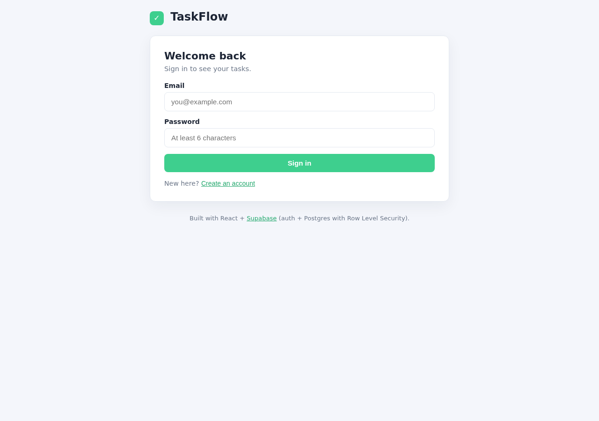
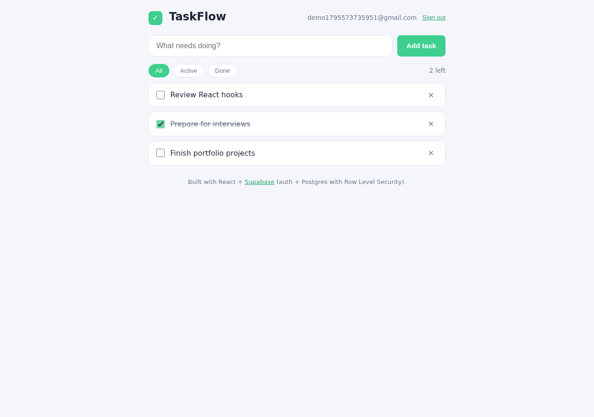
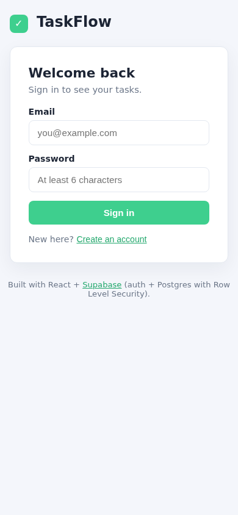

# TaskFlow - Task Tracker with Supabase

A full-stack task tracker built with React and
[Supabase](https://supabase.com). Create an account, sign in from any device,
and manage your tasks: add, complete, filter and delete. Tasks live in a real
Postgres database and every user only ever sees their own, enforced by Row
Level Security.

**Live demo:** https://malakmo7amed309.github.io/task-tracker/

## Features

- Email + password authentication (sign up, sign in, sign out) with Supabase
  Auth; email confirmation is disabled so demo accounts work instantly
- Add, complete and delete tasks, synced to a Postgres database
- Filters: All / Active / Done, plus a live "tasks left" counter
- Optimistic UI: tasks appear, check off and disappear instantly, with
  automatic rollback if the server call fails
- Session persistence: stay signed in across page reloads
- Row Level Security: the database itself guarantees users can only read and
  write their own rows
- Loading, error-with-retry and empty states
- Clean light theme, fully responsive

## Tech stack

- React 19 + Vite
- Supabase: Auth, Postgres database, auto-generated REST API, Row Level
  Security
- `@supabase/supabase-js` client
- Plain modern CSS (custom properties, flexbox)

## Screenshots

| Sign in | Task list |
| --- | --- |
|  |  |

| Mobile |
| --- |
|  |

## Database setup

The app needs one table with RLS enabled. This is the exact SQL (run it in
the Supabase SQL editor):

```sql
create table if not exists public.tasks (
  id uuid primary key default gen_random_uuid(),
  user_id uuid not null references auth.users(id) on delete cascade,
  title text not null check (char_length(title) > 0),
  is_complete boolean not null default false,
  created_at timestamptz not null default now()
);

alter table public.tasks enable row level security;

create policy "own tasks select" on public.tasks
  for select using (auth.uid() = user_id);
create policy "own tasks insert" on public.tasks
  for insert with check (auth.uid() = user_id);
create policy "own tasks update" on public.tasks
  for update using (auth.uid() = user_id);
create policy "own tasks delete" on public.tasks
  for delete using (auth.uid() = user_id);

grant select, insert, update, delete on public.tasks to authenticated;
grant select, insert, update, delete on public.tasks to anon;
```

(The `grant` lines matter: tables created through the SQL editor are not
automatically exposed to the API roles, and without them every request
returns `permission denied for table tasks`.)

## Run locally

```bash
npm install
npm run dev
```

Then open http://localhost:5173/task-tracker/.

To create a production build:

```bash
npm run build
npm run preview
```

The Supabase URL and publishable key in `src/supabase.js` are safe to commit:
the publishable key is designed for browsers, and Row Level Security is what
actually protects the data.

## How the code works

New to this codebase? Read [docs/how-it-works.md](docs/how-it-works.md) for a
plain-language walkthrough of the auth flow, Row Level Security, optimistic
updates and the main React concepts used here.
